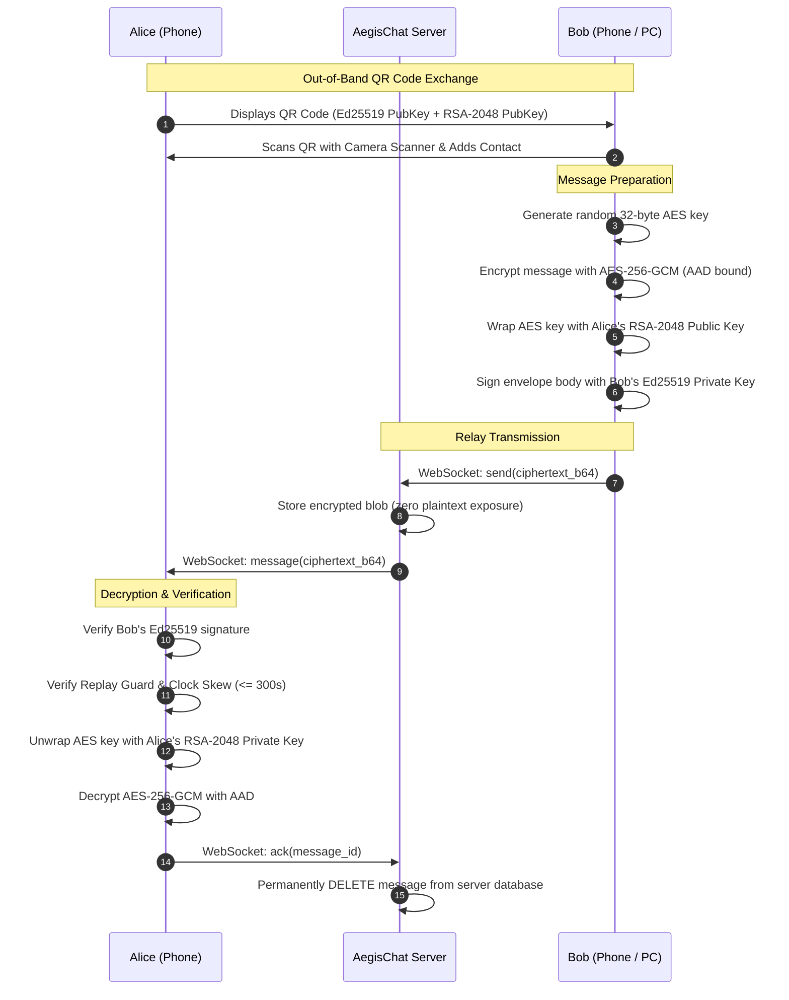

# AegisChat: Security & Cryptographic Architecture

AegisChat is engineered around a **zero-trust, zero-knowledge threat model**. The communication relay server is considered potentially untrusted and compromised. All message confidentiality, integrity, and authenticity are guaranteed end-to-end between client endpoints.

---

## 1. Threat Model & Security Guarantees

| Attack Vector | Mitigation Mechanism |
| :--- | :--- |
| **Server Wiretapping / Compromise** | Zero plaintext ever leaves the device. The server only sees ciphertext envelopes and cannot unwrap the symmetric AES keys or forge sender signatures. |
| **Man-in-the-Middle (MITM)** | Public keys are exchanged out-of-band via encrypted QR codes. Contacts can be cryptographically verified using a symmetric 60-digit safety number. Key changes automatically trigger security alerts and revoke verification status. |
| **Replay Attacks** | Every message envelope contains a unique `message_id`, an 8-byte millisecond timestamp, and must pass an in-memory replay guard cache. |
| **Clock Skew Attacks** | Envelopes with timestamps deviating by more than ±300 seconds from local UTC are rejected. |
| **Physical Device Seizure** | Database files are encrypted at rest with AES-256-GCM. Decryption keys are derived on-the-fly using Argon2id from a user PIN and stored in hardware secure enclaves. |
| **Shoulder Surfing / Memory Dumps** | Android enforces `FLAG_SECURE` to block OS screenshots and task switcher previews. iOS applies `UIBlurEffect` upon backgrounding. OS-level backups (`allowBackup="false"`) are disabled. |
| **PIN Brute-Force** | Progressive exponential delays are enforced on incorrect PIN attempts with an automatic local key wipe after 10 consecutive failed attempts. |

---

## 2. Cryptographic Primitives

* **Symmetric Message Cipher**: AES-256-GCM with a fresh CSPRNG 96-bit (12-byte) nonce per message.
* **Key Encapsulation Mechanism (KEM)**: RSA-2048 using OAEP padding with SHA-256 digest and MGF1.
* **Digital Signatures**: Ed25519 (Edwards-curve Digital Signature Algorithm).
* **Device Authentication**: ECDSA over NIST P-256 (secp256r1) with SHA-256.
* **Key Derivation Function (KDF)**: Argon2id (`t=3`, `m=64MB`, `p=4`) for PIN-to-database-key derivation.
* **Safety Number Fingerprint**: SHA-512 over symmetrically sorted public keys, mapped into 12 blocks of 5 decimal digits (60 digits total).

---

## 3. Protocol Envelope Specification (Binary v1)

All messages transmitted over WebSockets are binary envelopes serialized according to the following layout:

```
+---------+------------+-------------+------------+----------------+------------+----------------+
| Version | Sender Len | Sender ID   | Recip Len  | Recipient ID   | Msg ID Len | Message ID     |
| (1 B)   | (1 B)      | (Variable)  | (1 B)      | (Variable)     | (1 B)      | (Variable)     |
+---------+------------+-------------+------------+----------------+------------+----------------+
| Timestamp (8 B, Big-Endian)        | Wrapped AES-256 Key (256 B)                                  |
+------------------------------------+-------------------------------------------------------------+
| Nonce (12 B)                       | MAC Tag (16 B)                                              |
+------------------------------------+-------------------------------------------------------------+
| Ciphertext Length (4 B, Big-Endian)| Ciphertext Payload (Variable Length)                        |
+------------------------------------+-------------------------------------------------------------+
| Ed25519 Digital Signature (64 B)                                                                 |
+--------------------------------------------------------------------------------------------------+
```

### Associated Authenticated Data (AAD)
Before AES-256-GCM encryption, canonical AAD is constructed:
```text
AAD = utf8(sender_id + ":" + recipient_id + ":" + message_id + ":" + timestamp)
```
Any tampering with sender, recipient, message ID, timestamp, or ciphertext results in immediate GCM authentication tag verification failure.

### Envelope Digital Signature
The sender signs the entire binary envelope body (all bytes preceding the trailing 64-byte signature) with their Ed25519 private key. The recipient validates this signature against the sender's verified public signing key before opening the payload.

---

## 4. Identity & Key Exchange



---

## 5. Local Storage & Hardware Keystore Integration

1. **At-Rest Encryption**: Messages are persisted locally into encrypted storage. Each record is sealed with AES-256-GCM.
2. **Key Protection**:
   - On Android: Master encryption keys are protected using Android Keystore hardware-backed keys.
   - On iOS: Master keys are isolated in the iOS Secure Enclave / Keychain.
3. **App Lock Protection**: An Argon2id hash of the user's PIN unlocks the in-memory keys upon application launch. If the application remains in the background for over 60 seconds, it automatically re-locks.
