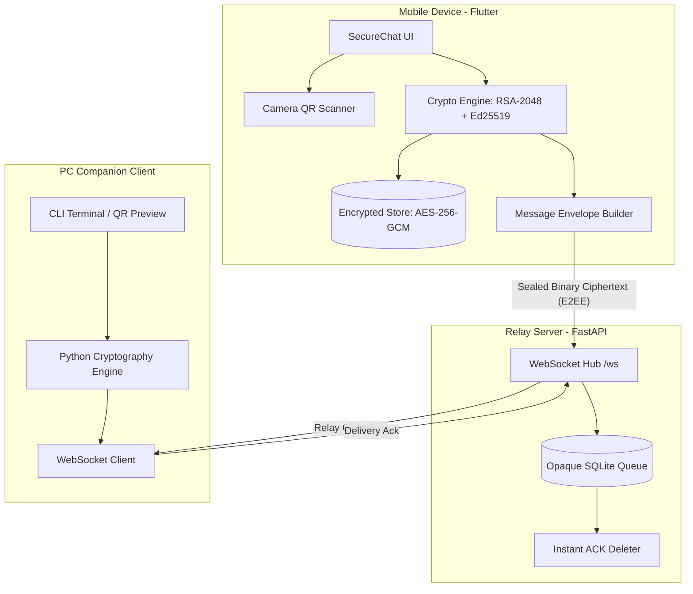

# AegisChat: Zero-Knowledge, Hardware-Backed Encrypted Messenger

<p align="center">
  
  
  
  
  
  
  
</p>

AegisChat is a modern, privacy-first mobile messaging application engineered to deliver **provable zero-plaintext confidentiality**, cryptographic non-repudiation, and hardware-backed key protection across an untrusted relay server.

---

## 🌟 Key Highlights

* 📷 **Visual QR Identity & Live Camera Scanner**: Pair contacts out-of-band in seconds. Generate high-contrast QR codes and scan them with an integrated camera scanner featuring torch toggle and viewfinder framing.
* 🛡️ **Zero-Knowledge Relay Server**: The relay server processes only opaque Base64-encoded encrypted envelopes. It **never** has access to message plaintext or private keys. Messages are permanently deleted upon delivery acknowledgement (`ack`).
* 🔐 **Dual-Layer Asymmetric Cryptography**: Combines **RSA-2048 OAEP-SHA256** for ephemeral key encapsulation and **Ed25519** for digital envelope signatures.
* 🔒 **Encrypted At-Rest Storage**: Local SQLite message and contact stores are encrypted with AES-256-GCM. Keys are derived using **Argon2id** (`t=3`, `m=64MB`, `p=4`) from user PINs and hardware-backed Android Keystore / iOS Keychain enclaves.
* 👁️ **Anti-Surveillance Screen Privacy**: Enforces `FLAG_SECURE` on Android to prevent screenshots, screen recordings, and recent app switcher leaks. Enforces `UIBlurEffect` on iOS backgrounding. Backup extraction (`allowBackup="false"`) is disabled.
* 🔢 **60-Digit Safety Number Verification**: Symmetrically computes an out-of-band SHA-512 fingerprint displayed in 12 groups of 5 digits. Detects any public key change or MITM attempt with visual security warnings.
* 💻 **Interactive PC Companion Terminal**: Comes with a companion client that allows testing real-time E2EE messaging between your mobile device and your PC directly over local Wi-Fi.

---

## 🏗️ Architecture Overview



---

## 🛡️ Cryptographic Specification

| Component | Primitive / Algorithm | Details |
| :--- | :--- | :--- |
| **Symmetric Cipher** | **AES-256-GCM** | Fresh 96-bit CSPRNG nonce per message; 128-bit authentication tag |
| **Key Encapsulation** | **RSA-2048 OAEP** | SHA-256 digest with MGF1 mask generation |
| **Digital Signatures** | **Ed25519** | 64-byte signature over the full binary envelope body |
| **Device Authentication** | **ECDSA P-256** | Challenge-response authentication against server relay |
| **Key Derivation** | **Argon2id** | 3 iterations, 64 MB memory, 4 parallelism lanes |
| **Tamper Defense** | **AAD Binding** | Authenticated Additional Data binds `sender:recipient:msg_id:timestamp` |
| **Replay Protection** | **Replay Guard** | In-memory message ID cache + ±300s clock skew window |

---

## 🚀 Quick Start Guide

### 1. Prerequisites
* **Python**: 3.10+ (with `pip`)
* **Flutter**: 3.47+ (Dart 3.13+)
* **Java**: OpenJDK 17 LTS
* **Android SDK**: API Level 34+

---

### 2. Start the Backend Server

```bash
# 1. Install server requirements
cd server
pip install -r requirements.txt

# 2. Run the FastAPI relay server
python -m uvicorn app.main:app --host 0.0.0.0 --port 8000
```
> The server listens on `0.0.0.0:8000` and is accessible by all devices on your local Wi-Fi.

---

### 3. Generate a One-Time Registration Invite Code

```bash
python server/manage.py create-invite --expires-hours 24
```
Output:
```text
swZzMYRvLiyNbvc1Q7HFRSD90pLCM52O
```

---

### 4. Build & Install the Mobile App

```bash
cd app
flutter pub get
flutter build apk --debug
```

#### Install via Local Wi-Fi (No Cable Needed):
1. Serve the APK:
   ```bash
   python -m http.server 8080 --directory app/build/app/outputs/flutter-apk
   ```
2. Open your phone's browser and go to `http://<YOUR_PC_IP>:8080/app-debug.apk`.
3. Download and install.

---

### 5. Chat with the PC Companion Client

Start the companion test user (**Alice**) on your PC:
```bash
python -u tools/companion_client.py
```
- Alice renders an **ASCII QR code directly in the terminal**.
- Open `http://<YOUR_PC_IP>:8080/alice_qr.html` in your browser to view a large QR code on your PC monitor.
- In the mobile app, tap the **QR Scanner icon** (`Icons.qr_code_scanner`), point your camera at the PC monitor, and chat in real-time with full end-to-end encryption!

---

## 🧪 Comprehensive Test Suite

AegisChat is backed by an extensive automated test suite covering cryptographic primitives, UI interactions, network protocols, and platform security flags:

```bash
# 1. Run Flutter unit & widget tests (65/65 passing)
cd app && flutter test

# 2. Run static analysis (0 issues)
cd app && flutter analyze

# 3. Run server backend tests (27/27 passing)
python -m pytest server/tests

# 4. Verify Android & iOS privacy compliance flags
python tools/check_platform_flags.py
```

---

## 📄 License

This project is licensed under the [MIT License](LICENSE).
